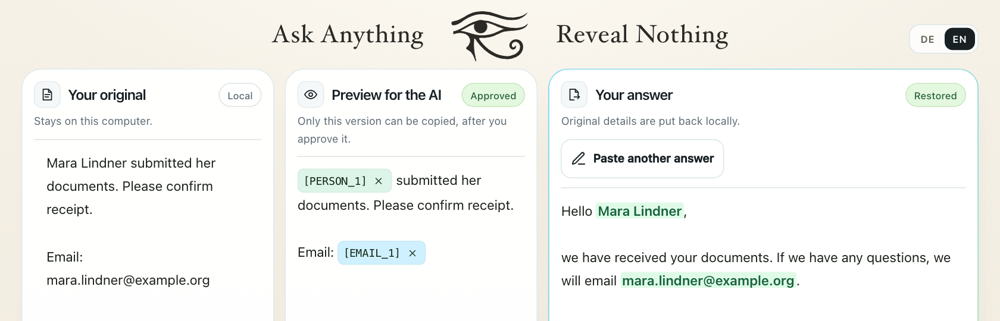

# Horus · Use AI. Keep your data.

**Horus replaces sensitive details with placeholders on your computer.** For example, “Erika Musterfrau” becomes `[PERSON_1]`. You review the masked text before sharing it with a chatbot. Horus restores the original values in the reply on your computer.

[Deutsch](README.md) · [Quick start](#quick-start) · [How it works](#how-it-works) · [Limits](#limits)

## Quick start

1. [Download the Horus preview for Apple silicon Macs](https://github.com/lxc-ht/Horus/releases/download/v0.1.0-preview.1/Horus-macOS-AppleSilicon.zip) and extract the ZIP.
2. Double-click `Start Horus.command`. Horus opens in your browser in English. The first launch requires internet access and several gigabytes of free space for Python packages and the detection model.
3. Load the built-in example and analyze it. The sample uses fictional details.

<details>
<summary>Run from the repository</summary>

Install uv, then clone the repository or download the ZIP from GitHub and extract it. Run these commands from the repository folder.

```bash
uv sync
uv run --locked --extra web uvicorn web.app:app --host 127.0.0.1 --port 8000
```

Open `http://127.0.0.1:8000` in your browser and select **EN**. Installation was tested on macOS. See the [German setup notes](README.md#schnellstart) for Gatekeeper and download instructions.

</details>

## How it works

Mara Lindner submitted her documents. You want a chatbot to draft an acknowledgment. The name and email address are fictional.

1. **Analyze.** Horus replaces the name with `[PERSON_1]` and the email address with `[EMAIL_1]`.
2. **Review and approve.** Check the entire preview. Once you approve it, copy that version into the chatbot.
3. **Restore the reply.** Paste the reply with its placeholders back into Horus. The restored name and email address appear in green in the local reply.



*Screenshot from Horus after restoring a prepared sample reply.*

## Limits

Pseudonymization can leave identifying clues in the surrounding text, and detection can miss sensitive information. Review the full preview before approving it. Whether a workflow complies with privacy rules depends on how you use it.

## Testing and development

In a sample of 12 fictional documents, Horus fully replaced 32 of 36 annotated values and produced five false positives. See the [sample and method](benchmarks/README.md) and the [German README](README.md#tests-und-entwicklung) for installation measurements, development commands and architecture.

## Credits and license

Built by Team Horus at the Leuphana AI Hackathon 2026. [MIT license](LICENSE)
