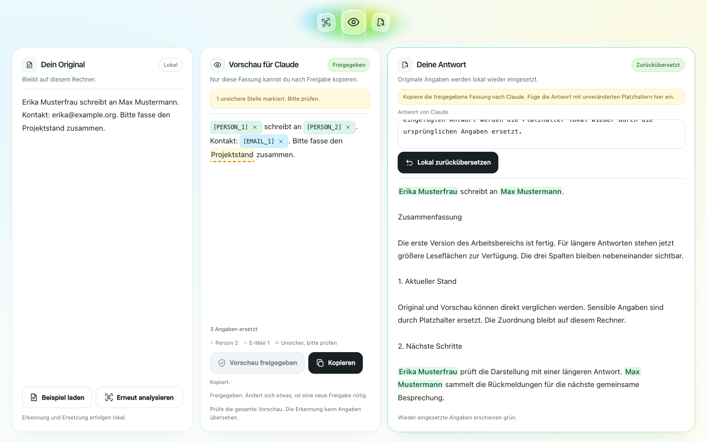

# LP7 – KI nutzen. Daten behalten.

LP7 ersetzt Namen, Adressen, IBANs und andere sensible Angaben in einem Text durch Platzhalter wie `[PERSON_1]`, bevor er an eine KI geht. Die Antwort setzt LP7 danach wieder mit den echten Angaben zusammen. Alles läuft auf dem eigenen Rechner, und nichts geht raus, was ein Mensch nicht vorher geprüft und freigegeben hat.

Gedacht für Kanzleien, Arztpraxen und Steuerbüros, die Claude oder einen anderen Chatbot nutzen wollen, aber keine Mandanten- oder Patientendaten auf fremde Server geben dürfen.


## So funktioniert es

1. **Text einfügen.** Einen Brief, eine E-Mail oder einen Sachverhalt.
2. **Analysieren.** LP7 erkennt Personen, Firmen, Adressen, Orte, E-Mail, Telefon, IBAN, Datum und Kennungen wie Aktenzeichen oder Steuer-ID und ersetzt sie durch Platzhalter. Die Zuordnung bleibt lokal.
3. **Prüfen und freigeben.** Du siehst genau den Text, der rausgehen würde. Unsichere Stellen sind gelb markiert, Übersehenes markierst du selbst, falsche Treffer nimmst du mit × zurück.
4. **Kopieren und fragen.** Den freigegebenen Text kopierst du selbst in Claude oder einen anderen Chatbot. LP7 sendet nichts automatisch und braucht keinen API-Schlüssel.
5. **Zurückübersetzen.** Die Antwort fügst du wieder ein. LP7 setzt die echten Angaben ein und meldet alles, was es nicht eindeutig zuordnen kann, statt zu raten.



## Installation

Getestet auf macOS. Beim ersten Start lädt LP7 Python-Pakete aus dem Internet; bei der ersten Analyse kommt das Erkennungsmodell hinzu.

**Mac-Messung vom 06.11.2026:** macOS 26.6.1, Apple M4, WLAN eingeschaltet, Internetzugang, frischer Klon und leere, getrennte uv- und Hugging-Face-Caches. uv 0.13.7, Python 3.12.16 bereits vorhanden (Python-Installation und dessen Speicherbedarf nicht gemessen). Paket- und Analyseschritte einzeln mit `/usr/bin/time -p` gemessen, jeweils die verstrichene Zeit (`real`); Serverbereitschaft mit einer monotonen Uhr (`time.perf_counter`):

| Schritt | Gemessen auf diesem Mac |
| --- | --- |
| Python-Pakete: `uv sync` | 12,40 Sekunden |
| Web-Pakete samt Importprüfung | 1,84 Sekunden |
| Speicher nach beiden Paketschritten | `.venv`: 795.008 KiB (`du -sh`: 776M); uv-Cache: 825.008 KiB (806M) |
| Erste Analyse von `examples/kanzlei.txt`, einschließlich Modelldownload und Laden in den Speicher | 94,07 Sekunden; 16 Ersetzungen |
| Modellcache (`HF_HOME`) nach der ersten Analyse | 1.133.200 KiB (`du -sh`: 1,1G), einschließlich der vom Modell benötigten Dateien |
| Zweite Analyse in einem neuen Prozess, Modell im Cache, Netz an | 10,22 Sekunden; 16 Ersetzungen |
| Analyse ohne Netz simuliert mit `HF_HUB_OFFLINE=1 UV_OFFLINE=1`, WLAN weiterhin an | 9,74 Sekunden; 16 Ersetzungen |
| Serverstart mit gefüllten Caches und `HF_HUB_OFFLINE=1`, bis `/api/status` auf Port 8768 antwortete | 1,273 Sekunden; Status `fake: false` (Abfrageintervall 0,05 Sekunden) |

Paketinstallation und erste Analyse dauerten zusammen **108,31 Sekunden** (Summe der drei getrennt gemessenen Schritte, kein gemessener Doppelklick-Start). Größen sind belegter Speicher laut `du -sk`, keine Downloadmengen; Umgebung und Cache sind getrennt ausgewiesen und werden nicht als zusätzlicher physischer Gesamtbedarf addiert. Reine Modelldownloadzeit, übertragene Datenmenge und Betrieb mit tatsächlich ausgeschaltetem WLAN: **nicht gemessen**. Den Test mit ausgeschaltetem WLAN übernimmt Paul beim Probedurchlauf.

**Linux-Vergleich vom 05.11.2026:** Linux in der Cloud, mit Internetzugang, aber gesperrtem Hugging Face; Python und Pakete belegten 5,8 GB, das Laden dauerte 7 Minuten (einschließlich Grafikkarten-Paketen für torch). Modellgröße und -ladezeit wurden dort nicht gemessen; Distribution und Chip sind nicht dokumentiert.

**1. uv installieren** (einmalig, im Terminal):

```bash
curl -LsSf https://astral.sh/uv/install.sh | sh
```

**2. LP7 herunterladen:** oben auf dieser Seite „Code“ → „Download ZIP“ und entpacken. Oder mit Git:

```bash
git clone https://github.com/lxc-ht/LP7.git
```

**3. Starten:** Doppelklick auf `LP7 starten.command`. Der Browser öffnet sich mit http://127.0.0.1:8000. Das Terminalfenster bleibt offen, solange LP7 läuft. Zum Beenden ctrl+C drücken oder das Fenster schließen.

Blockiert macOS das Öffnen, weil die Datei aus dem Internet kommt: Systemeinstellungen → Datenschutz & Sicherheit → „Trotzdem öffnen“.

**Ohne Doppelklick**, zum Beispiel auf Windows oder Linux (dort nicht getestet), im LP7-Ordner:

```bash
uv sync
uv run --with-requirements web/requirements.txt uvicorn web.app:app --host 127.0.0.1 --port 8000
```

Die Oberfläche ist nur auf diesem Rechner erreichbar (127.0.0.1), nicht im Netzwerk.

## Was LP7 nicht ist

- **Pseudonymisierung ist keine Anonymisierung.** Auch ohne Namen kann der Zusammenhang eine Person verraten („die einzige Kinderärztin in Ort X“, eine seltene Diagnose, ein bekannter Rechtsstreit). Deshalb ist die menschliche Prüfung vor jeder Freigabe Pflicht.
- Die Erkennung ist nicht vollständig. Ein Modell übersieht Namen, Regex-Muster decken nicht jedes Format ab. Der Leck-Check fängt nur Werte, die der Harness schon kennt.
- Das Werkzeug macht einen Prozess nicht automatisch DSGVO-konform. Es ist ein technischer Baustein, der die Prüfung durch einen Menschen unterstützt.
- Keine Rechtsberatung. Ob und wie ihr KI mit Mandanten- oder Patientendaten nutzen dürft, klärt ihr mit eurer Datenschutzberatung.

## Bekannte Eigenheiten

- **Nachnamen und Vornamen allein werden mitmaskiert.** Ist „Erika Musterfrau“ als `[PERSON_1]` erkannt, wird aus „Frau Musterfrau“ „Frau [PERSON_1]“. Das gilt für Namensteile ab 3 Zeichen, nur als ganzes Wort („Musterfrauenverband“ bleibt stehen) und nur, wenn der Teil zu genau einer Person der Sitzung gehört. Teilen sich zwei Personen einen Nachnamen („Max Mustermann“, „Erika Mustermann“), bleibt „Mustermann“ allein stehen und der Harness warnt mit beiden Platzhaltern.
- **Die Rückübersetzung setzt immer den vollen Namen ein.** Aus „Frau [PERSON_1]“ in der Antwort wird „Frau Erika Musterfrau“, nicht „Frau Musterfrau“. Das ist so gewollt: Der Platzhalter steht für die Person, nicht für die Schreibweise, und ein voller Name ist in der lokalen Antwort unschädlich.

## Getestet

- Rückweg mit echtem Claude (claude.ai, Kopiermodus, 05.11.2026): 16 von 16 Platzhaltern, die Claude in seinen Antworten benutzt hat, kamen heil zurück, in 2 erfundenen Testtexten. Keine Person wurde verwechselt. Zwei Texte sind eine Stichprobe, kein Beweis.
- Installation frisch durchgespielt (05.11.2026, Linux in der Cloud, leerer Klon und leere Caches): Pakete laden, Server starten und 213 Tests liefen durch. Das Erkennungsmodell ließ sich dort nicht laden, weil die Umgebung Hugging Face sperrt; dieser Schritt ist nicht geprüft.
- Installation und Analyse auf dem Mac nachgemessen (06.11.2026, macOS 26.6.1, Apple M4, WLAN an, Internetzugang): frischer Klon und leere Caches, erste und zweite Analyse sowie ohne Netz simuliert mit `HF_HUB_OFFLINE=1` und `UV_OFFLINE=1` erfolgreich, jeweils 16 Ersetzungen in `examples/kanzlei.txt`; Server auf Port 8768 gestartet und beendet. Zeiten und Größen stehen unter „Installation“. WLAN tatsächlich aus: nicht gemessen.
- Die Erkennung ist mit erfundenen Texten geprüft, nicht mit echten Akten. Eine Erkennungsrate für echte Dokumente gibt es noch nicht.

## Für Entwicklerinnen und Entwickler

```bash
uv sync
uv run pytest              # ohne Netz, ohne Modell-Download
uv run pytest -m slow      # zusätzlich mit dem GLiNER-Modell
uv run python -m harness run examples/kanzlei.txt   # Kommandozeile
```

Ohne API-Key (siehe `.env.example`) läuft die Kommandozeile im Kopiermodus: Der freigegebene Text landet in der Zwischenablage, die Antwort fügt man von Hand wieder ein. Die Weboberfläche und ihr Testmodus sind in [`web/README.md`](web/README.md) beschrieben, Icons und Komponenten im [UI Kit](web/ui-kit/README.md).

**Aufbau**

- `src/harness/api.py` – der Vertrag, gegen den die Weboberfläche (`web/`) programmiert.
- `detect.py` (Regex + GLiNER), `vault.py` (SQLite), `mask.py`, `gate.py` (Freigabe und Leck-Check), `cloud.py` (Claude), `restore.py`, `cli.py`.
- `examples/` – vollständig erfundene Beispieltexte.

Die Regeln für Beiträge und Agenten stehen in [`CLAUDE.md`](CLAUDE.md), der Arbeitsstand des Teams in [`PROJEKTSTAND.md`](PROJEKTSTAND.md).

## Entstehung

Gebaut beim Leuphana AI Hackathon 2026 von [lxc-ht](https://github.com/lxc-ht) und [Phantom-create-1](https://github.com/Phantom-create-1).

### Danksagung

Einige deutsche Erkennungsmuster (Handelsregister, USt-IdNr mit Prüfziffer, Bezeichner für Reisepass und Führerschein) und die Idee, unsichere Muster über Kontextwörter abzusichern, stammen aus [Microsoft Presidio](https://github.com/data-privacy-stack/presidio), MIT-Lizenz, Copyright (c) Presidio Contributors.

## Lizenz

[MIT](LICENSE): Du darfst LP7 nutzen, verändern und weitergeben, auch kommerziell, solange der Lizenzhinweis erhalten bleibt. Ohne Gewähr. Die aus Microsoft Presidio übernommenen Muster stehen ebenfalls unter MIT (siehe Danksagung).
