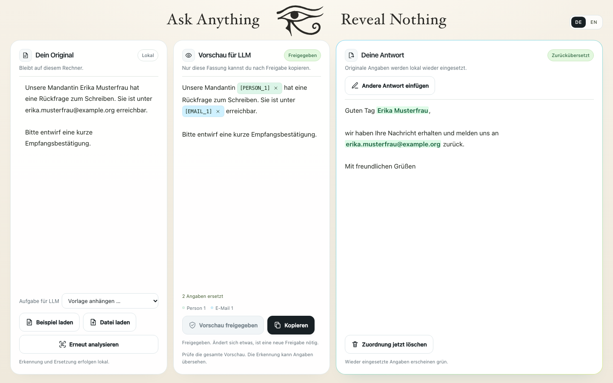

# Horus · KI nutzen. Daten behalten.

**Horus ersetzt sensible Angaben lokal durch Platzhalter.** Aus „Erika Musterfrau“ wird zum Beispiel `[PERSON_1]`. Du prüfst den maskierten Text, bevor du ihn an einen Chatbot weitergibst. Horus setzt die Originalwerte in der Antwort anschließend lokal wieder ein.

[Auf dem Mac starten](#schnellstart) · [Ablauf ansehen](#so-funktioniert-es) · [Grenzen kennen](#grenzen)


## Schnellstart

1. [Horus für Macs mit Apple Chip herunterladen](https://github.com/lxc-ht/Horus/releases/download/v0.1.0-preview.1/Horus-macOS-AppleSilicon.zip) und die ZIP Datei entpacken. Das Paket ist eine Vorschau.
2. `Horus starten.command` doppelklicken. Die Oberfläche öffnet sich im Browser. Beim ersten Start lädt Horus die nötigen Pakete und das Erkennungsmodell. Dafür brauchst du Internet und mehrere GB freien Speicher.
3. **Beispiel laden** und dann **Text analysieren** wählen. Das Beispiel enthält frei erfundene Angaben.

<details>
<summary>Aus dem Repository starten</summary>

**1. uv installieren** (einmalig, im Terminal):

```bash
curl -LsSf https://astral.sh/uv/install.sh | sh
```

**2. Horus herunterladen:** oben auf dieser Seite „Code“ → „Download ZIP“ und entpacken. Oder mit Git:

```bash
git clone https://github.com/lxc-ht/Horus.git
```

**3. Starten:** Doppelklick auf `Horus starten.command`. Der Browser öffnet sich mit http://127.0.0.1:8000. Das Terminalfenster bleibt offen, solange Horus läuft. Zum Beenden ctrl+C drücken oder das Fenster schließen.

Blockiert macOS das Öffnen, weil die Datei aus dem Internet kommt: Systemeinstellungen → Datenschutz & Sicherheit → „Trotzdem öffnen“.

**Ohne Doppelklick**, zum Beispiel auf Windows oder Linux (dort nicht getestet), im Horus-Ordner:

```bash
uv sync
uv run --locked --extra web uvicorn web.app:app --host 127.0.0.1 --port 8000
```

Die Oberfläche ist nur auf diesem Rechner erreichbar (127.0.0.1), nicht im Netzwerk.

</details>

## So funktioniert es

1. **Einfügen und analysieren.** Gib deinen Text ein oder lade eine PDF, Word Datei oder E-Mail. Horus ersetzt erkannte Namen, Adressen, Kontodaten und andere sensible Angaben durch Platzhalter.
2. **Prüfen und freigeben.** Kontrolliere die Vorschau und ergänze fehlende Stellen. Gelbe Markierungen zeigen unsichere Treffer. Erst nach deiner Freigabe lässt sich die Vorschau kopieren.
3. **Kopieren und zurückübersetzen.** Füge die freigegebene Fassung in einen Chatbot deiner Wahl ein. Kopiere dessen Antwort zurück in Horus, um die Originalwerte lokal wieder einzusetzen.

Horus sendet im Browser nichts automatisch. Die Zuordnung zwischen Platzhaltern und Originalwerten bleibt auf deinem Rechner.

<details>
<summary>Die Oberfläche am Kanzleibeispiel ansehen</summary>



</details>

## Grenzen

**Pseudonymisierung ist keine Anonymisierung.** Horus kann Angaben übersehen. Auch der Zusammenhang kann Rückschlüsse auf Personen zulassen. Prüfe deshalb die gesamte Vorschau vor jeder Freigabe.

<details>
<summary>Erkennungsgrenzen und Verhalten bei Namen</summary>

- Die Erkennung ist nicht vollständig. Ein Modell übersieht Namen, Regex-Muster decken nicht jedes Format ab. Der Leck-Check fängt nur Werte, die der Harness schon kennt.
- Das Werkzeug macht einen Prozess nicht automatisch DSGVO-konform. Es ist ein technischer Baustein, der die Prüfung durch einen Menschen unterstützt.
- Keine Rechtsberatung. Ob und wie ihr KI mit Mandanten- oder Patientendaten nutzen dürft, klärt ihr mit eurer Datenschutzberatung.

**Bekannte Eigenheiten**

- **Nachnamen und Vornamen allein werden mitmaskiert.** Ist „Erika Musterfrau“ als `[PERSON_1]` erkannt, wird aus „Frau Musterfrau“ „Frau [PERSON_1]“. Das gilt für Namensteile ab 3 Zeichen, nur als ganzes Wort („Musterfrauenverband“ bleibt stehen) und nur, wenn der Teil zu genau einer Person der Sitzung gehört. Teilen sich zwei Personen einen Nachnamen („Max Mustermann“, „Erika Mustermann“), bleibt „Mustermann“ allein stehen und der Harness warnt mit beiden Platzhaltern.
- **Die Rückübersetzung setzt immer den vollen Namen ein.** Aus „Frau [PERSON_1]“ in der Antwort wird „Frau Erika Musterfrau“, nicht „Frau Musterfrau“. Das ist so gewollt: Der Platzhalter steht für die Person, nicht für die Schreibweise, und ein voller Name ist in der lokalen Antwort unschädlich.

</details>

## Tests und Entwicklung

Die Erkennung wurde mit erfundenen Texten geprüft. Ergebnisse und Messmethode stehen in der [Erkennungsstichprobe](benchmarks/README.md).

<details>
<summary>Testergebnisse und Installationsmessungen</summary>

- Rückweg mit echtem Claude (claude.ai, Kopiermodus, 05.11.2026): 16 von 16 Platzhaltern, die Claude in seinen Antworten benutzt hat, kamen heil zurück, in 2 erfundenen Testtexten. Keine Person wurde verwechselt. Zwei Texte sind eine Stichprobe, kein Beweis.
- Installation frisch durchgespielt (05.11.2026, Linux in der Cloud, leerer Klon und leere Caches): Pakete laden, Server starten und 213 Tests liefen durch. Das Erkennungsmodell ließ sich dort nicht laden, weil die Umgebung Hugging Face sperrt; dieser Schritt ist nicht geprüft.
- Installation auf dem Mac gemessen (06.11.2026, macOS 26.6.1, Apple M4, WLAN an, frischer Klon, leere Caches, Python 3.12 und uv 0.13.7 schon vorhanden):

  | Schritt | Gemessen |
  | --- | --- |
  | Python-Pakete laden (`uv sync` und Web-Pakete) | 14 Sekunden |
  | Belegter Speicher danach | `.venv` 776 MB, uv-Cache 806 MB |
  | Erste Analyse samt Download des Modells | 94 Sekunden, 16 Ersetzungen |
  | Modell im Cache (`HF_HOME`) | 1,1 GB |
  | Zweite Analyse in neuem Prozess (Modell laden) | 10 Sekunden, 16 Ersetzungen |
  | Analyse ohne Netz, simuliert mit `HF_HUB_OFFLINE=1 UV_OFFLINE=1` | 10 Sekunden, 16 Ersetzungen |
  | Serverstart mit gefüllten Caches, bis `/api/status` antwortet | 1,3 Sekunden |

  Größen sind belegter Speicher (`du`), keine Downloadmengen. Nicht gemessen: die übertragene Datenmenge und der Betrieb mit tatsächlich ausgeschaltetem WLAN.
- Erkennungsstichprobe mit 12 erfundenen Texten: 32 von 36 markierten Angaben vollständig ersetzt, vier übersehen (drei Kennungen, ein englisches Datum), fünf Falschtreffer. [Stichprobe und Messmethode](benchmarks/README.md).

</details>

<details>
<summary>Entwicklungsbefehle und Aufbau</summary>

```bash
uv sync
uv run --locked python -m pytest  # ohne Modell-Download
uv run --locked --extra web python -m web.test_app
uv run pytest -m slow      # zusätzlich mit dem GLiNER-Modell
uv run python -m harness run examples/kanzlei.txt   # Kommandozeile
```

Ohne API-Key (siehe `.env.example`) läuft die Kommandozeile im Kopiermodus: Der freigegebene Text landet in der Zwischenablage, die Antwort fügt man von Hand wieder ein. Die Weboberfläche und ihr Testmodus sind in [`web/README.md`](web/README.md) beschrieben, Icons und Komponenten im [UI Kit](web/ui-kit/README.md).

**Aufbau**

- `src/harness/api.py` – der Vertrag, gegen den die Weboberfläche (`web/`) programmiert.
- `detect.py` (Regex + GLiNER), `vault.py` (SQLite), `mask.py`, `gate.py` (Freigabe und Leck-Check), `cloud.py` (Claude), `restore.py`, `cli.py`.
- `examples/` – vollständig erfundene Beispieltexte.

Die Regeln für Beiträge und Agenten stehen in [`CLAUDE.md`](CLAUDE.md), der Arbeitsstand des Teams in [`PROJEKTSTAND.md`](PROJEKTSTAND.md).

</details>

## Entstehung

Gebaut beim Leuphana AI Hackathon 2026 von Team Horus: [lxc-ht](https://github.com/lxc-ht) und [Phantom-create-1](https://github.com/Phantom-create-1).

### Danksagung

Einige deutsche Erkennungsmuster (Handelsregister, USt-IdNr mit Prüfziffer, Bezeichner für Reisepass und Führerschein) und die Idee, unsichere Muster über Kontextwörter abzusichern, stammen aus [Microsoft Presidio](https://github.com/data-privacy-stack/presidio), MIT-Lizenz, Copyright (c) Presidio Contributors.

## Lizenz

[MIT](LICENSE): Du darfst Horus nutzen, verändern und weitergeben, auch kommerziell, solange der Lizenzhinweis erhalten bleibt. Ohne Gewähr.
