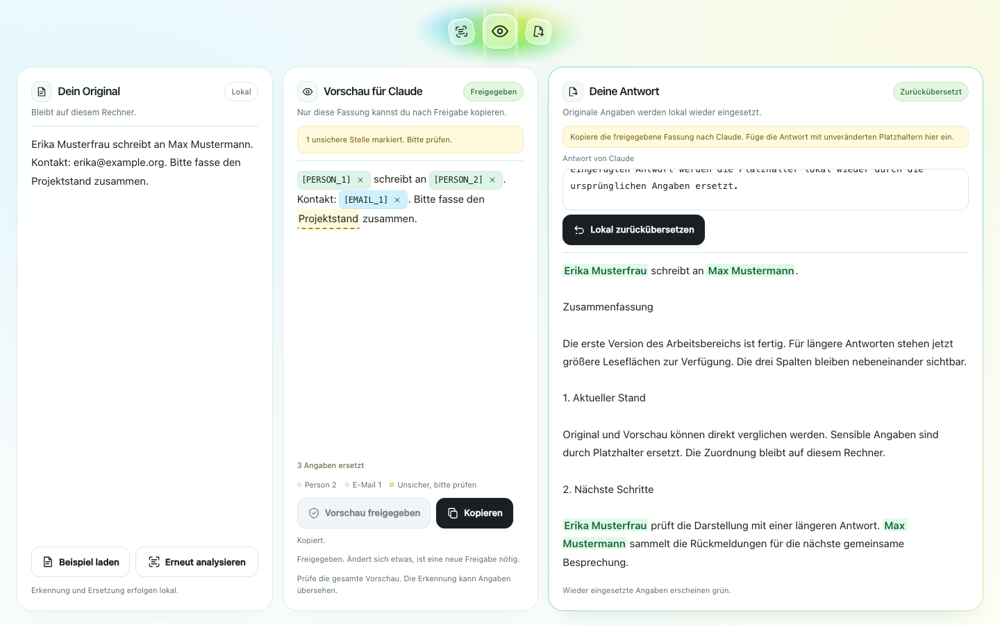

# Weboberfläche

Alle Befehle aus dem Repo-Root, einmal vorher `uv sync` (siehe README im Root).

Mit echtem Kern:

    uv run --with-requirements web/requirements.txt uvicorn web.app:app --host 127.0.0.1 --port 8000

Mit Attrappe:

    HARNESS_FAKE=1 uv run --with-requirements web/requirements.txt uvicorn web.app:app --host 127.0.0.1 --port 8000

Danach http://127.0.0.1:8000 öffnen. Das erste Analysieren lädt das Modell und dauert länger, also vor der Demo einmal auslösen.

## Arbeitsoberfläche

Layout A ist direkt in `web/static/index.html` eingebaut: drei flexible Spalten mit hellen Arbeitsflächen und einem feinen Farbrand. Auf dem Desktop wird die genutzte Spalte durch Hover, Klick oder Tastaturfokus breiter. Beim Schreiben in einem Eingabefeld und bei markiertem Text ist der Hoverwechsel ausgesetzt. Auf Mobilgeräten bleiben die Bereiche untereinander. Das Glasmotiv steht zwischen „Klar. Lokal.“ und „Unter deiner Kontrolle.“ frei ohne äußeren Rahmen. Die mittlere Spalte heißt „Vorschau für LLM“. Das Motiv ist klein und mittig; die äußere Kopfzeile, Schrittleiste und der Footer sind entfernt. Die Legende erklärt erkannte Datentypen und markierte unsichere Stellen. Die Oberfläche verwendet den echten Kern, sofern sie nicht ausdrücklich mit `HARNESS_FAKE=1` gestartet wird.

## Datei laden

„Datei laden“ oder eine Datei auf das Feld „Dein Original“ ziehen setzt ihren Text ins Feld. Das geht mit digitalen PDFs, Word-Dateien (.docx) und E-Mails (.eml). Scans erkennt LP7 nicht und meldet das, ebenso alte .doc- und Outlook-.msg-Dateien. Bei Word kommen Kopf- und Fußzeilen und Fußnoten mit, gelöschter Text aus „Änderungen nachverfolgen“ nicht. Eine Tabellenzeile wird eine Textzeile, die Zellen durch Tabulator getrennt, damit „IBAN“ neben dem Wert stehen bleibt. Bei E-Mails kommen Absender, Empfänger, Datum und Betreff mit, Anhänge nicht. Die Datei geht nur vom Browser an den lokalen Server auf 127.0.0.1, wird dort im Speicher gelesen und nirgends gespeichert oder protokolliert. Analysiert wird erst, wenn du selbst auf „Text analysieren“ klickst; eine vorherige Analyse und Freigabe verfallen beim Laden, ebenso bei „Beispiel laden“ und bei jeder Änderung am Text. Kann eine Datei nicht gelesen werden, steht die Meldung direkt unter „Dein Original“.

## UI prüfen

Die Oberfläche lädt keine externen Fonts, Skripte oder Bilder. Die drei Arbeitsschritte passen sich an Desktop und Handy an. Die Freigabe bleibt vor dem Kopieren zwingend. Die Weboberfläche arbeitet im Kopiermodus: Text lokal analysieren, Vorschau prüfen und freigeben, die Fassung selbst nach Claude kopieren und dessen Antwort zur lokalen Rückübersetzung einfügen. Es gibt keinen automatischen Versand.

Server bewusst mit der Attrappe starten:

    HARNESS_FAKE=1 uv run --with-requirements web/requirements.txt uvicorn web.app:app --host 127.0.0.1 --port 8000

In einem zweiten Terminal die Browserprüfung ausführen. Playwright ist nur für diese Prüfung nötig, nicht für die App:

    uv run --no-project --with playwright playwright install chromium --only-shell
    uv run --no-project --with playwright python -m web.test_ui

Die Prüfung nutzt erfundene Daten mit der lokalen Attrappe, es geht keine Anfrage an Claude. Sie prüft Sperrzustände, Kopieren, Rückübersetzung, Freigabeverlust nach einer Änderung, den aktuellen Arbeitsbereich, die Unsicher Legende, fünf Bildschirmbreiten, Hover, Klick, Tastatur, geschützte Textauswahl, Touch und reduzierte Bewegung. Für einen anderen lokalen Port kann die URL als Argument übergeben werden.

## UI Kit

Das [vollständige UI Kit](ui-kit/README.md) liegt direkt in diesem Repository unter `web/ui-kit/`: 18 SVG Icons, drei Looks, Komponentendemos und interaktive Beispieldurchläufe. Es startet im bestätigten **Lime Soda** Look. Im Abschnitt **Dashboard** lassen sich die Variante mit Banner und die Glas Ablaufleiste ausprobieren, einschließlich Freigabe und erneuter Sperre nach Änderungen.

Aus dem Repository starten:

    python3 -m http.server 8013 --bind 127.0.0.1 --directory web/ui-kit

Danach [UI Kit öffnen](http://127.0.0.1:8013). Es läuft unabhängig vom Kern und benötigt keinen API Schlüssel. Einstieg und Bearbeitungshinweise für die gemeinsame Weiterentwicklung stehen in der [Kit Anleitung](ui-kit/README.md#gemeinsam-weiterarbeiten).
