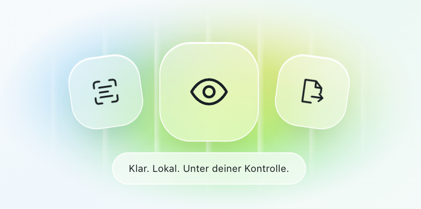
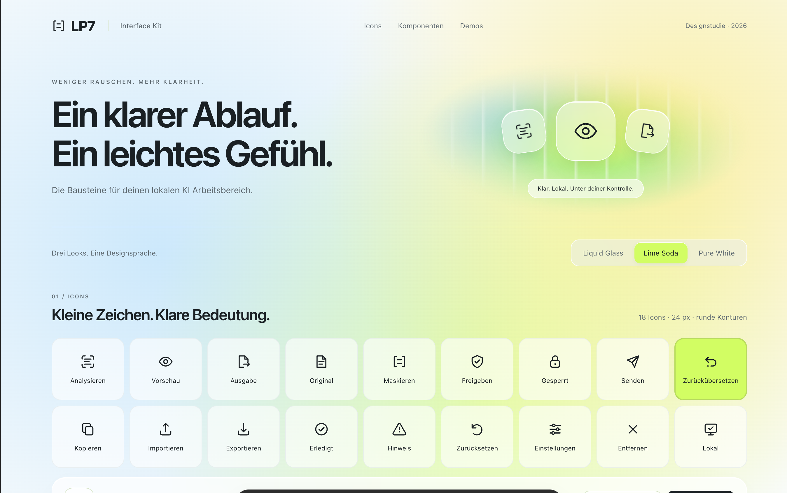
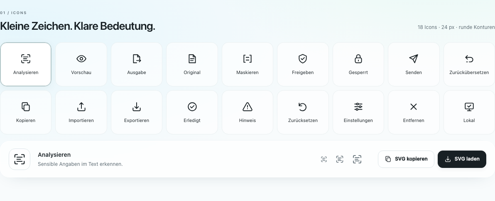
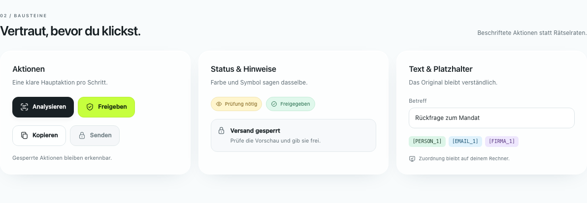
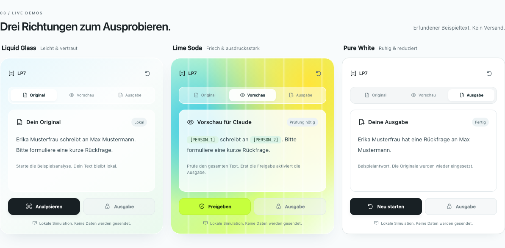

# LP7 UI Kit

18 SVG Icons, wiederverwendbare Komponenten und drei klickbare Demos für einen lokalen KI Arbeitsbereich.



## Enthalten

1. **18 Icons:** Analysieren, Vorschau, Ausgabe, Original, Maskieren, Freigeben, Gesperrt, Senden, Zurückübersetzen, Kopieren, Importieren, Exportieren, Erledigt, Hinweis, Zurücksetzen, Einstellungen, Entfernen und Lokal.
2. **Drei Looks:** Liquid Glass, Lime Soda und Pure White, direkt im Kit umschaltbar.
3. **Komponenten:** beschriftete Buttons, Sperrzustände, Statusanzeigen, Hinweise, Eingaben und Platzhalter.
4. **Drei Ablaufdemos:** Beispielsanalyse, Vorschau, Freigabe, simulierte Ausgabe und Zurücksetzen. Jede Demo funktioniert unabhängig; vor der Freigabe bleibt die Ausgabe gesperrt.
5. **Gestaltungsideen:** das bestätigte Banner sowie zwei Vorschläge zur Einbindung im Dashboard.

## Ausprobieren

Im gemeinsamen LP7 Repository `web/ui-kit/index.html` im Browser öffnen. Es gibt keinen Buildschritt und keine Laufzeitabhängigkeiten. Für den abgebildeten Look oben **Lime Soda** auswählen.

Für zuverlässigen Zugriff auf die Zwischenablage und die Browserprüfung aus dem LP7 Repository starten:

```sh
python3 -m http.server 8013 --bind 127.0.0.1 --directory web/ui-kit
```

Danach [http://127.0.0.1:8013](http://127.0.0.1:8013) öffnen.

Die Demos nutzen feste erfundene Beispieldaten. Erkennung, Maskierung und Antwort werden simuliert. Das Kit ist eine Designstudie und hat keine Verbindung zum LP7 Kern oder zu Claude.

## Vorschau









## Icons verwenden

Alle Icons liegen einzeln unter [icons/](icons/) und gebündelt in [icons.zip](icons.zip). Im Kit ein Icon auswählen und als SVG kopieren oder herunterladen.

- Zeichenfläche: 24 × 24 Pixel.
- Strichstärke: 1.75, runde Enden und Ecken.
- Farbe: `currentColor`, bei direkt eingebettetem SVG über CSS `color` steuerbar.
- Keine externen Referenzen oder Schriftdateien.

```html
<button type="button">
  
  Analysieren
</button>
```

Bei `` erbt `currentColor` die Farbe des umgebenden HTML nicht. Für farbige Icons die SVG direkt einbetten. Rein dekorative SVG mit `aria-hidden="true"` markieren. Aktionen erhalten eine sichtbare Beschriftung oder einen aussagekräftigen `aria-label`.

Die Geometrien wurden für dieses Kit gezeichnet. Die Symbole in [index.html](index.html) sind die bearbeitbare Quelle. Bei Änderungen auch die entsprechenden SVG Dateien und [icons.zip](icons.zip) aktualisieren.

## Banner und Dashboard Ideen

Die Grafik liegt unter [assets/banner.png](assets/banner.png). Die folgenden Dashboard Bilder sind Gestaltungsvorschläge, keine weiteren implementierten App Ansichten.

1. [Das komplette Motiv kompakt rechts neben dem Titel](assets/dashboard-kopfbereich.png).
2. [Die drei Glas Icons als Ablaufleiste über den Arbeitsbereichen](assets/dashboard-ablaufleiste.png).

## Gemeinsam weiterarbeiten

Das vollständige Kit liegt unter `web/ui-kit/` im gemeinsamen [LP7 Repository](https://github.com/lxc-ht/LP7). Bestehende LP7 Mitarbeitende benötigen keinen Zugang zu einem weiteren Repository.

1. Aktuellen Stand mit `git pull` holen.
2. Für eigene Änderungen einen Arbeitsbranch anlegen, zum Beispiel `git switch -c codex/ui-kit-anpassung`.
3. Struktur und Icons in [index.html](index.html), Farben und Layout in [kit.css](kit.css) sowie Interaktionen in [kit.js](kit.js) bearbeiten.
4. Browserprüfung ausführen und Änderungen als Pull Request nach `main` einreichen.

Die drei Farbvarianten bleiben im Kit umschaltbar. Die Startansicht nutzt Liquid Glass; der Screenshot zeigt die Auswahl Lime Soda. Die Hauptoberfläche liegt getrennt unter `web/static/`.

## Browserprüfung

Den lokalen Server wie oben starten, dann in einem zweiten Terminal:

```sh
uv run --no-project --with playwright playwright install chromium --only-shell
uv run --no-project --with playwright python web/ui-kit/test_kit.py
```

Die Prüfung testet alle 18 SVG Dateien und das ZIP, Icon Auswahl, Zwischenablage, SVG Download, drei Looks, die drei Ablaufdemos einschließlich Freigabesperre und Zurücksetzen sowie fünf Bildschirmbreiten von 320 bis 1440 Pixeln. Sie prüft außerdem JavaScript Fehler und unerwartete Netzwerkanfragen. Für einen anderen Port die URL als Argument übergeben.

## Aufbau

| Datei | Inhalt |
| --- | --- |
| [index.html](index.html) | Struktur, Komponenten und eingebettete Icon Symbole |
| [kit.css](kit.css) | Drei Looks und responsive Darstellung |
| [kit.js](kit.js) | Icon Export, Designauswahl und lokale Ablaufdemos |
| [icons/](icons/) | 18 eigenständige SVG Dateien |
| [assets/](assets/) | Banner und Vorschaubilder |
| [test_kit.py](test_kit.py) | Wiederholbare Browserprüfung |

Das Kit lädt keine externen Fonts, Skripte oder Bilder und benötigt keinen API Schlüssel.
