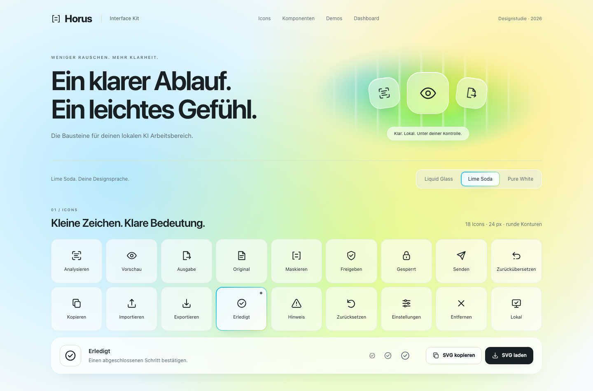
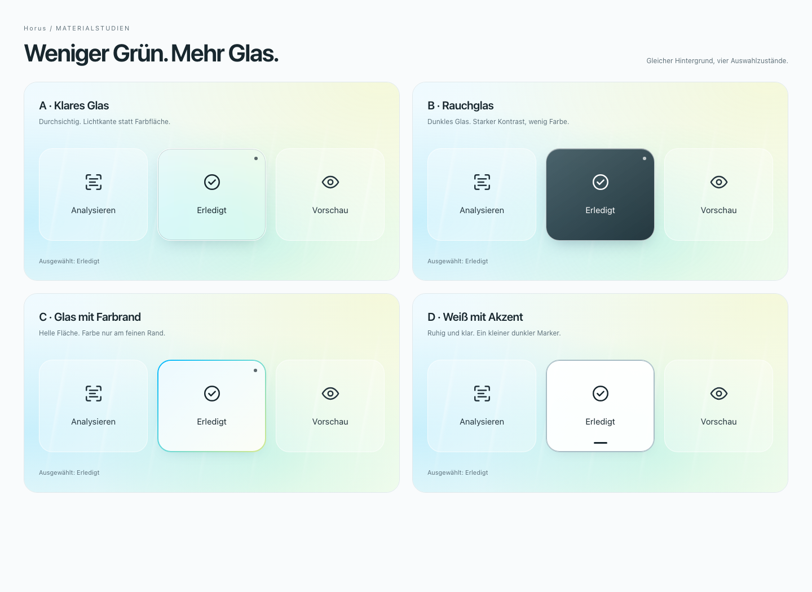
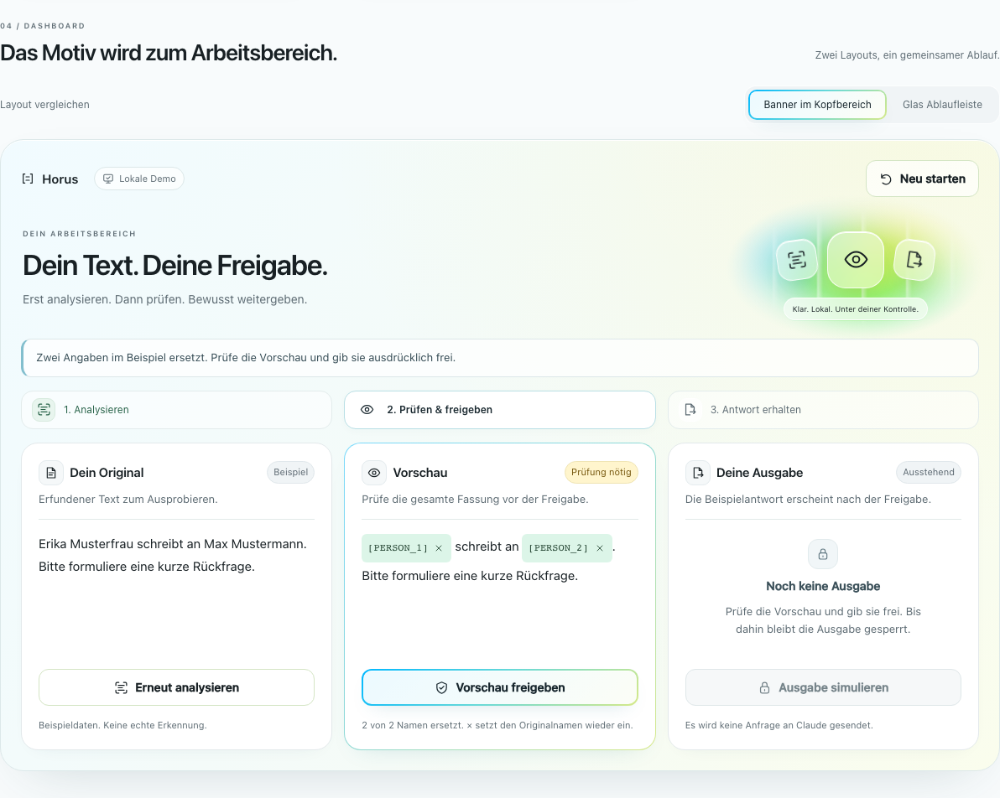
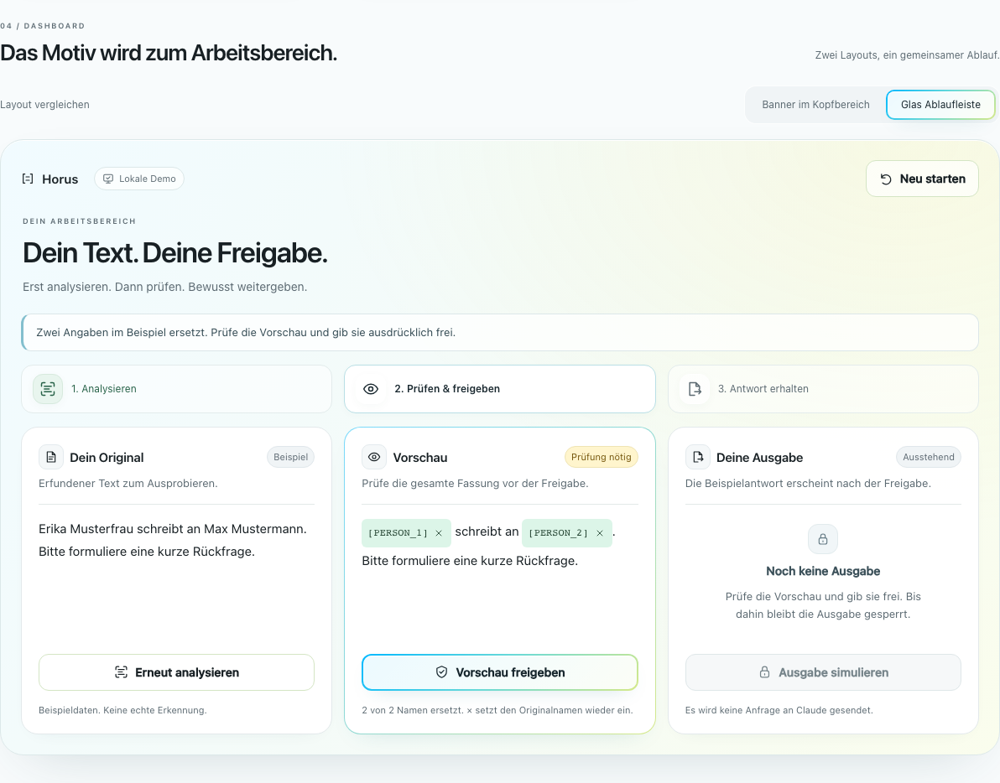

# Horus UI Kit

18 SVG Icons, wiederverwendbare Komponenten und drei klickbare Demos für einen lokalen KI Arbeitsbereich.


## Enthalten

1. **18 Icons:** Analysieren, Vorschau, Ausgabe, Original, Maskieren, Freigeben, Gesperrt, Senden, Zurückübersetzen, Kopieren, Importieren, Exportieren, Erledigt, Hinweis, Zurücksetzen, Einstellungen, Entfernen und Lokal.
2. **Lime Soda mit Material C als Standard:** heller Cyan/Mint/Lime/Gelb Verlauf und schwarze Typografie. Ausgewählte Icon Kacheln, aktive Schalter und Freigabe Buttons haben helle Glasflächen mit feinem Farbrand. Liquid Glass und Pure White bleiben zum Vergleichen umschaltbar.
3. **Komponenten:** beschriftete Buttons, Sperrzustände, Statusanzeigen, Hinweise, Eingaben und Platzhalter.
4. **Drei Ablaufdemos:** Beispielsanalyse, Vorschau, Freigabe, simulierte Ausgabe und Zurücksetzen. Jede Demo funktioniert unabhängig; vor der Freigabe bleibt die Ausgabe gesperrt.
5. **Interaktives Dashboard:** Banner im Kopfbereich oder Glas Ablaufleiste, drei Arbeitsbereiche sowie Freigabe und simulierte Ausgabe. Eine Änderung an den Platzhaltern verwirft Freigabe und Ausgabe.

## Ausprobieren

Im gemeinsamen Horus Repository `web/ui-kit/index.html` im Browser öffnen. Es gibt keinen Buildschritt und keine Laufzeitabhängigkeiten. Das Kit startet mit dem bestätigten **Lime Soda** Look.

Für zuverlässigen Zugriff auf die Zwischenablage und die Browserprüfung aus dem Horus Repository starten:

```sh
python3 -m http.server 8013 --bind 127.0.0.1 --directory web/ui-kit
```

Danach [http://127.0.0.1:8013](http://127.0.0.1:8013) öffnen.

Die Demos nutzen feste erfundene Beispieldaten. Erkennung, Maskierung und Antwort werden simuliert. Das Kit ist eine Designstudie und hat keine Verbindung zum Horus Kern oder zu Claude.

## Vorschau




## Weniger grüne Auswahlflächen

Loc hat **C · Glas mit Farbrand** ausgewählt. Dieser Stil ist jetzt im Lime Soda Look für ausgewählte Icon Kacheln, aktive Schalter und verfügbare Freigabe Buttons umgesetzt. Die Kacheln erhalten zusätzlich einen kleinen Auswahlmarker. Deaktivierte Aktionen bleiben gesperrt und neutral dargestellt.

Die vier ursprünglichen Materialstudien bleiben zum Vergleich verfügbar:



1. **A · Klares Glas:** transparenter Hintergrund mit Lichtkante und Schatten.
2. **B · Rauchglas:** dunkles, leicht durchsichtiges Glas mit weißem Inhalt.
3. **C · Glas mit Farbrand:** fast weiße Fläche und ein feiner Cyan/Mint Rand.
4. **D · Weiß mit Akzent:** neutrale Fläche, dezenter Rand und kleiner dunkler Marker.

Die [bearbeitbare Vergleichsvorlage](materialstudien.html) enthält alle vier Varianten als eigenständige Seite ohne Abhängigkeiten. Die [Materialwerte](assets/materialstudien/materialien.json) enthalten Füllung, Rand, Schatten und Textfarbe. Zu jeder Variante liegen [Einzelbilder und Ansichten im Kit und Dashboard](assets/materialstudien/) vor.

## Icons verwenden

Alle Icons liegen einzeln unter [icons/](icons/) und gebündelt in [icons.zip](icons.zip). Im Kit ein Icon auswählen und als SVG kopieren oder herunterladen.

- Zeichenfläche: 24 × 24 Pixel.
- Strichstärke: 1.75, runde Enden und Ecken.
- Farbe: `currentColor`, bei direkt eingebettetem SVG über CSS `color` steuerbar.
- Keine externen Referenzen oder Schriftdateien.

```html
<button type="button">
  
  Analysieren
</button>
```

Bei `` erbt `currentColor` die Farbe des umgebenden HTML nicht. Für farbige Icons die SVG direkt einbetten. Rein dekorative SVG mit `aria-hidden="true"` markieren. Aktionen erhalten eine sichtbare Beschriftung oder einen aussagekräftigen `aria-label`.

Die Geometrien wurden für dieses Kit gezeichnet. Die Symbole in [index.html](index.html) sind die bearbeitbare Quelle. Bei Änderungen auch die entsprechenden SVG Dateien und [icons.zip](icons.zip) aktualisieren.

## Banner und Dashboard Ideen

Die Grafik liegt unter [assets/banner.png](assets/banner.png). Im Abschnitt **Dashboard** sind beide Layouts jetzt interaktiv: eine Variante mit dem Glasmotiv im Kopfbereich und eine kompaktere Variante mit Glas Icons in der Ablaufleiste. Beim Layoutwechsel bleibt der aktuelle Bearbeitungsstand erhalten. Das Dashboard ist direkt im Menü erreichbar. Helle Arbeitsflächen, ein dezenter Verlauf und größere Texte erleichtern das Lesen. Die nummerierten Schritte und der Hinweis über den Arbeitsbereichen zeigen den nächsten Schritt. Nach der Analyse führt der Tastaturfokus zur Vorschau, nach der Freigabe zur Ausgabe. Erneut analysieren bleibt als Nebenaktion verfügbar; die Freigabe nutzt weiterhin Material C. Der aktuelle Arbeitsbereich erhält ebenfalls den Farbrand; abgeschlossene Schritte werden dezent markiert. Leere Bereiche erklären die nächste Aktion. Nach der Ausgabe geht der Fokus zur Antwort. Auf Mobilgeräten sind die Karten kompakter, alle drei Bereiche bleiben sichtbar.





Mit **Analysieren** die zwei Beispielnamen ersetzen, die Vorschau prüfen, **Freigeben** und **Ausgabe simulieren**. Das × an einem Platzhalter nimmt die Ersetzung zurück und sperrt die Ausgabe erneut. Auch eine erneute Analyse verwirft die vorherige Freigabe. **Neu starten** setzt die Demo zurück. Der Text ist ein festes erfundenes Beispiel, keine echte Modellerkennung oder API Verbindung.

Die früheren statischen Entwürfe bleiben als [Kopfbereich](https://github.com/lxc-ht/Horus/blob/9842718280a96edbd0f149da248c9c600eba5e26/web/ui-kit/assets/dashboard-kopfbereich.png) und [Ablaufleiste](https://github.com/lxc-ht/Horus/blob/9842718280a96edbd0f149da248c9c600eba5e26/web/ui-kit/assets/dashboard-ablaufleiste.png) verfügbar.

## Gemeinsam weiterarbeiten

Das vollständige Kit liegt unter `web/ui-kit/` im gemeinsamen [Horus Repository](https://github.com/lxc-ht/Horus). Bestehende Horus Mitarbeitende benötigen keinen Zugang zu einem weiteren Repository.

1. Aktuellen Stand mit `git pull` holen.
2. Für eigene Änderungen einen Arbeitsbranch anlegen, zum Beispiel `git switch -c codex/ui-kit-anpassung`.
3. Struktur und Icons in [index.html](index.html), Farben und Layout in [kit.css](kit.css) sowie Interaktionen in [kit.js](kit.js) bearbeiten.
4. Browserprüfung ausführen und Änderungen als Pull Request nach `main` einreichen.

Die Startansicht nutzt auf Locs Wunsch Lime Soda. Die drei Farbvarianten bleiben im Kit umschaltbar. Die Hauptoberfläche liegt getrennt unter `web/static/`.

## Browserprüfung

Den lokalen Server wie oben starten, dann in einem zweiten Terminal:

```sh
uv run --no-project --with playwright playwright install chromium --only-shell
uv run --no-project --with playwright python web/ui-kit/test_kit.py
```

Die Prüfung testet alle 18 SVG Dateien und das ZIP, Icon Auswahl, Zwischenablage, SVG Download, drei Looks, die drei Ablaufdemos sowie beide Dashboard Layouts. Geprüft werden Freigabesperre, Freigabeverlust nach Änderungen und erneuter Analyse, Layoutwechsel bei bestehender Freigabe und Zurücksetzen. Alle Ansichten werden auf seitlichen Überlauf bei fünf Bildschirmbreiten von 320 bis 1440 Pixeln geprüft. Die Prüfung erfasst außerdem JavaScript Fehler und unerwartete Netzwerkanfragen. Für einen anderen Port die URL als Argument übergeben.

## Aufbau

| Datei | Inhalt |
| --- | --- |
| [index.html](index.html) | Struktur, Komponenten und eingebettete Icon Symbole |
| [kit.css](kit.css) | Drei Looks und responsive Darstellung |
| [kit.js](kit.js) | Icon Export, Designauswahl und lokale Ablaufdemos |
| [icons/](icons/) | 18 eigenständige SVG Dateien |
| [assets/](assets/) | Banner und Vorschaubilder |
| [test_kit.py](test_kit.py) | Wiederholbare Browserprüfung |

Das Kit lädt keine externen Fonts, Skripte oder Bilder und benötigt keinen API Schlüssel.
